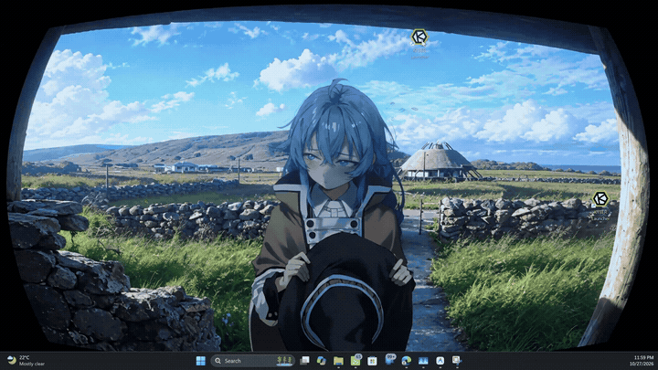

# Anemo

### An interactive 2.5D desktop environment and gaze-reactive live wallpaper.

Anemo transforms your desktop into a living visual canvas. Built as an open-source, ultra-low-footprint alternative to heavy video wallpaper software, Anemo pairs smooth hardware-accelerated video playback with real-time 2.5D gaze tracking, procedural eyelid deformation, and ambient soundscapes.

---

<div align="center">



*Gaze-reactive tracking running behind native Windows desktop icons.*  
*(High-definition capture available in [`demo/demo.mp4`](./demo/demo.mp4))*

</div>

---

## Architectural Principles

### Zero-Copy Dual Layer Compositing
Conventional interactive wallpaper engines suffer from high memory bandwidth consumption by reading raw uncompressed video frames into WebGL textures every frame (`gl.texImage2D`), saturating GPU buses with upwards of 880 MB/s of data transfers at 1440p.

Anemo addresses this with a zero-copy decoupled pipeline:
* **Background Plate:** The 2K video loop (`bg_loop.mp4`) decodes natively via Direct3D11 / NVDEC / QSV hardware video decoders inside an isolated presentation layer.
* **Reactive Foreground:** A transparent WebGL 2.0 surface sits directly above the video plate, executing shaders only for the 2.5D eye socket aperture, iris depth displacement, and procedural eyelid splines.
* **Net Result:** Average memory utilization drops from 650+ MB to under **26 MB JS heap**, and CPU usage remains below **0.3%**.

### 2.5D Gaze Tracking & Procedural Eyelids
* **Non-Linear Depth Rig:** The character's gaze dynamically computes eye socket parallax, iris angle, and corneal highlight positions with smooth non-linear interpolation.
* **Temporal Filtering:** Input coordinates pass through a calibrated One-Euro 2D filter, eliminating micro-jitter at low speeds while maintaining instant responsiveness during rapid saccades.
* **Eyelid Follow Dynamics:** Upper and lower eyelids flex dynamically with vertical gaze displacement, configurable across five distinct response curves (`Off`, `Subtle 30%`, `Natural 56%`, `Dynamic 75%`, `Maximum 100%`).
* **Iris Calibrations:** Dual stylistic presets:
  * *Classic (Set 1, Default):* Authentic anime iris proportions with soft ambient catchlights.
  * *Focused (Set 2):* Concentrated pupil radius with refined focal highlights.

### Native Windows Shell Integration
The desktop runtime (`Anemo.exe`) injects the wallpaper canvas directly into the Windows desktop hierarchy:
* Hooks between `Progman` and the `WorkerW` background plane, allowing desktop icons (`SysListView32`) and selection marquees to function uninhibited.
* Multi-monitor topology support: assign to Display 1, Display 2, or replicate across all monitors. Secondary displays automatically mute duplicate audio streams to preserve acoustic clarity and CPU cycles.
* Windows Startup auto-run persistence via user registry key `HKCU\Software\Microsoft\Windows\CurrentVersion\Run`.

### Acoustic Horizon
An ambient, atmospheric soundtrack sourced from *don't think about it anymore* runs asynchronously in the background. When enabled, playback begins from a randomized timestamp to prevent acoustic fatigue, looping continuously.

---

## Runtime Benchmarks

| Metric | Conventional WebGL Wallpaper | Anemo Architecture | Delta |
| :--- | :--- | :--- | :--- |
| **JS Heap RAM** | 640 – 670 MB | **26 MB** | -96% |
| **CPU Utilization** | 3.5% – 4.1% | **< 0.3%** | -92% |
| **Texture Bus Uploads** | 882 MB/s (60 FPS `texImage2D`) | **0 MB/s** (Hardware Native) | 100% Zero-Copy |
| **Multi-Monitor Duplicate** | Memory doubling, dropped frames | **60 FPS Synchronized** | Negligible overhead |

---

## Installation & Distribution

### 1. Windows Installer (Single Executable)
* Download **[`AnemoSetup.exe`](https://github.com/revolverocelot1/anemo-live-wallpaper/releases/download/v1.0.2/AnemoSetup.exe)** from the official [v1.0.2 Release](https://github.com/revolverocelot1/anemo-live-wallpaper/releases/tag/v1.0.2).
* Single click installation: unpacks to `%LocalAppData%\Programs\Anemo`, provisions Start Menu & Desktop shortcuts, and starts immediately in the system tray.

### 2. Portable Windows Package
* Download **[`Anemo-Live-Wallpaper-Portable.zip`](https://github.com/revolverocelot1/anemo-live-wallpaper/releases/download/v1.0.2/Anemo-Live-Wallpaper-Portable.zip)**.
* Extract to any directory and execute `Anemo.exe`. No elevated permissions or registry modifications required.

### 3. Web & Self-Hosted Engine
The web engine runs independently of the Windows host and can be served through any static host:

```bash
git clone https://github.com/revolverocelot1/anemo-live-wallpaper.git
cd anemo-live-wallpaper/web-engine

npm install
npm run dev
```

Browse to `http://localhost:5173` to launch the interactive canvas.

---

## Asset Portability & Engine Adapters

All segmented, calibrated raw assets are provided under [`assets-raw/`](./assets-raw) for creators and animators:
* `bg_loop.mp4` — High-definition 2K animated background plate.
* `face_anchor.png` — Isolated facial occlusion mask with transparent socket windows.
* `iris_layer.png`, `pupil_mask.png`, and iris presets — Calibrated displacement textures.
* `bgm.mp3` — Ambient atmospheric audio track.

You are welcome and encouraged to adapt these assets into third-party engines:
* **Steam Wallpaper Engine** (Scene / Web project)
* **Lively Wallpaper**
* **Native Unix / Wayland live wallpaper daemons**

*(Please maintain original artistic attribution in any derivative distributions.)*

---

## Roadmap: 2K Foundation & 4K Horizon

* **Current Fidelity (2K):** Anemo currently renders at **2560×1440 (2K)**. The source master illustration and animation plates were mastered at this resolution.
* **4K Ultra-Resolution Edition:** Work is underway to produce a native 4K release featuring:
  * Hand-retouched, high-density vector eyelid contours.
  * Re-rendered 4K background video loops.
  * Expanded character presets and atmospheric scene variants.

Community members experienced with high-resolution animation cleanup, shader compilation, and WebGL optimization are invited to collaborate.

---

## Contributing

Contributions focusing on performance, platform expansion, and artistic fidelity are warmly received:
* **GPU Shaders & Low-Power States:** Reducing wake-up cycles and integrating full-screen game detection.
* **Cross-Platform Hosts:** Standalone desktop wrappers for macOS (Metal / WKWebView) and Linux (Wayland / wlroots).
* **New Scene Presets:** Custom character anchors, weather effects, and lighting transitions.

Refer to the [Contributing Guide](./CONTRIBUTING.md) for technical conventions.

---

## Attribution & Legal

Anemo is created with deep gratitude to the original artists whose creative work inspired this project:

* **Visual Artwork:** Based on an edited artwork originally created by **[@aruhshura](https://x.com/aruhshura)**, featured in the video *["don't think about it anymore"](https://www.youtube.com/watch?v=A09aumNef-c)*.
* **Music & Sound:** Ambient audio sourced and looped from *["don't think about it anymore"](https://www.youtube.com/watch?v=A09aumNef-c)*.

All rights to the original artistic compositions and musical works belong to their respective creator.

The software is distributed under the [MIT License](./LICENSE).
